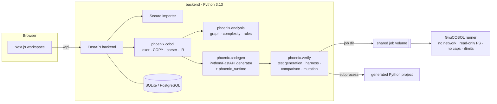
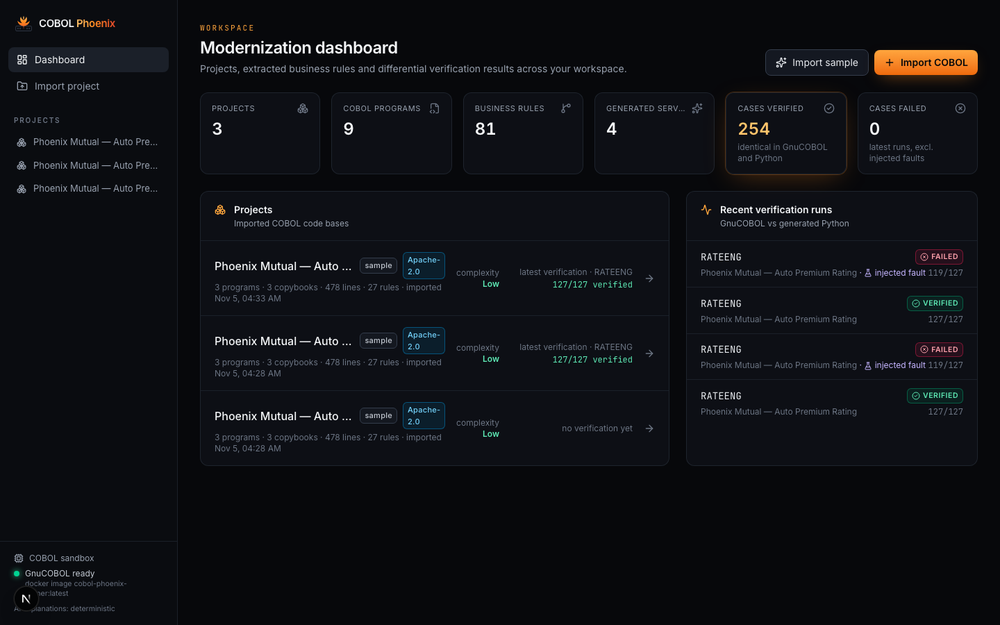
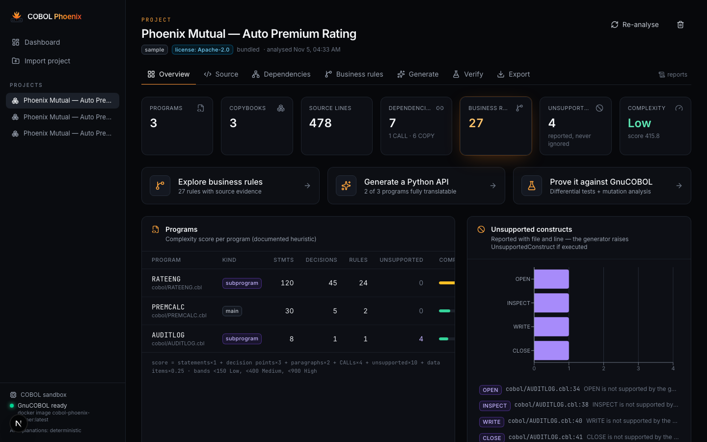
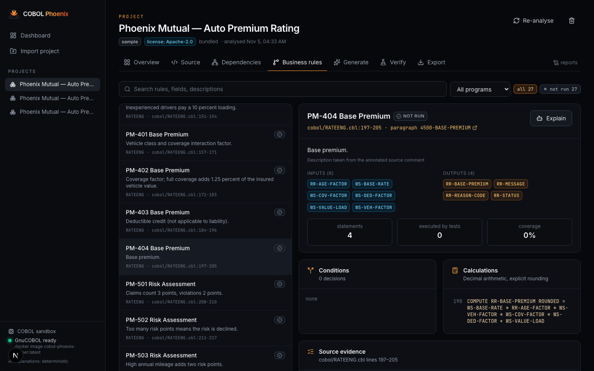
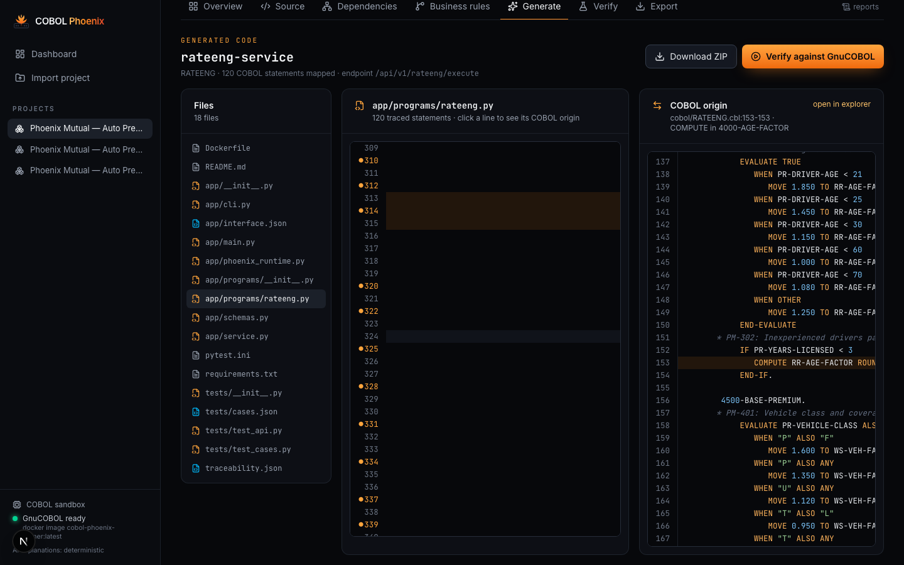
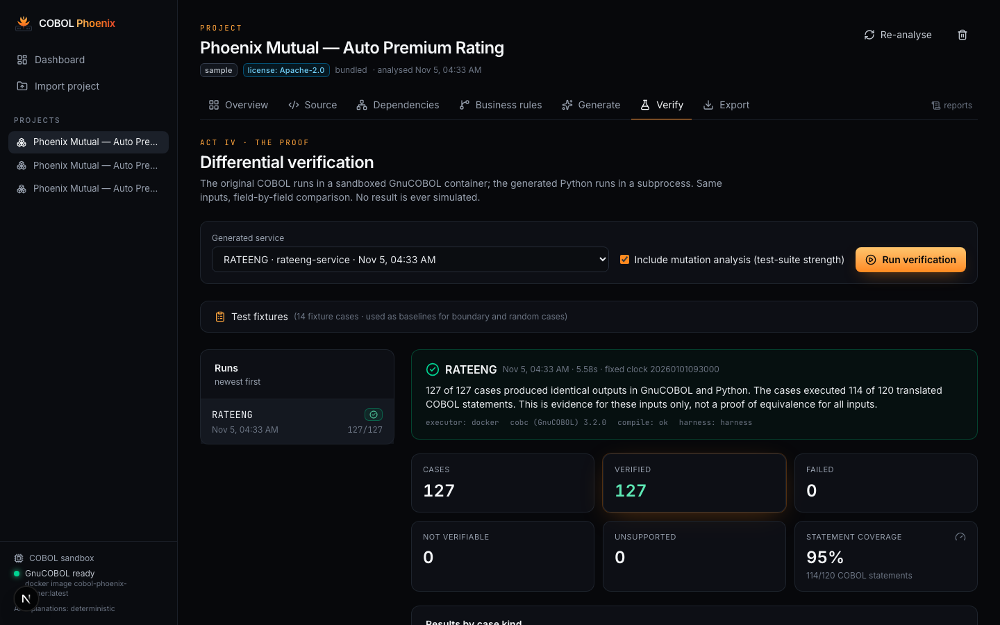
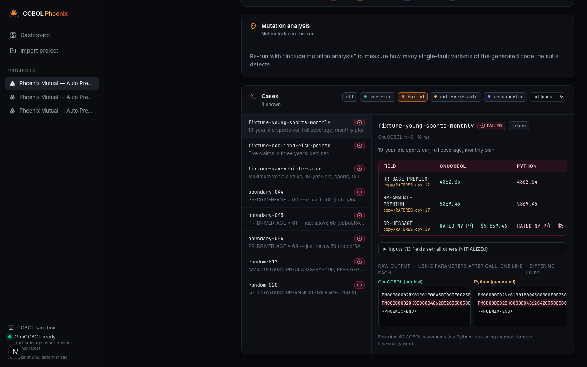

<p align="center"></p>

<h1 align="center">COBOL Phoenix</h1>
<p align="center"><b>From Mainframe to Modern. Preserve the Logic. Rebuild the Future.</b></p>
<p align="center">Evidence-backed COBOL → Python modernization, proven by differential testing against GnuCOBOL.</p>

---

## 1. What it is

COBOL Phoenix turns COBOL business logic into modern Python (FastAPI) services — and then **proves** the result.
It parses COBOL deterministically into an intermediate representation (IR), extracts business rules that cite
real source lines, generates an executable Python project with line-level traceability, and runs the original
program (in a sandboxed GnuCOBOL container) and the generated Python side by side on the same inputs.

It does **not** ask an LLM to translate COBOL. Parsing, rule extraction and code generation are deterministic;
an optional LLM can only add advisory explanations.

## 2. The problem

Banks and insurers still run critical calculations in COBOL. The logic is valuable, the people who wrote it are
gone, and modernization projects fail on one question: *does the new system behave exactly like the old one?*
Line-by-line translation (by hand or by AI) produces code nobody can trust without months of parallel runs.

COBOL Phoenix makes that question answerable early, cheaply and repeatedly: every claim is backed either by a
source citation or by an actual execution of both programs.

## 3. Key features

| Capability | What you get |
|---|---|
| **Secure import** | Upload files/ZIP, public GitHub repo (pinned ref), local directory (opt-in). Path traversal, symlinks, zip bombs, oversize and binary files rejected. Uploaded code is never executed during import or analysis. |
| **Deterministic COBOL analysis** | Fixed/free format lexer, COPY … REPLACING, recursive-descent parser, byte-accurate data layout (PIC, COMP, COMP-3, REDEFINES, OCCURS, 88-levels). Unsupported constructs are reported with file and line — never silently ignored. |
| **Dependency graph** | Programs, copybooks, CALL targets, PERFORM relations and record usage, every edge with its source location. |
| **Business rules with evidence** | Rules from paragraphs and source annotations (e.g. `NB-202:`), with inputs, outputs, conditions, calculations, decision tables and verification status. |
| **Python generation** | A complete FastAPI project per capability: Decimal business logic, Pydantic schemas from PICTURE clauses, endpoint, CLI, tests, README, Dockerfile and `traceability.json`. |
| **Differential verification** | GnuCOBOL (sandboxed) vs generated Python on fixtures, IR-derived boundary values, edge values and seeded random records; field-level diffs; statement coverage. |
| **Coverage-guided test placement** | Boundary values are attached to fixtures that actually execute the statement they came from. |
| **Mutation analysis & fault injection** | Single-fault mutants (drop ROUNDED, off-by-one comparisons, ± swaps, constant tweaks) measure test-suite strength; inject one on purpose to watch the verifier catch it. |
| **Reports** | Migration report, verification report (MD/JSON), business rules (MD/JSON), dependency graph JSON, traceability JSON, generated project ZIP. |

## 4. Architecture



Pipeline: **COBOL source → lexer/COPY → parser → normalized IR → rules & graph → Python generator → generated application → differential tests.**
Details: [docs/architecture.md](docs/architecture.md).

## 5. Screenshots

| | |
|---|---|
|  |  |
|  |  |
|  |  |

## 6. Demo video

_Placeholder — link to the public YouTube demo (under 3 minutes) goes here. Script: [submission/demo-script.md](submission/demo-script.md)._

## 7. Quick start (local development)

Requirements: Python 3.13, Node.js 20+, Docker (for the GnuCOBOL sandbox), `uv` (or pip).

```bash
make setup          # backend venv, frontend deps, GnuCOBOL runner image
make dev-backend    # http://localhost:8000  (API docs at /docs)
make dev-frontend   # http://localhost:3000
```

Open http://localhost:3000 → **Import sample** → follow the tabs: Overview → Business rules → Generate → Verify.
Without Docker the product still works; verification runs then report `NOT_VERIFIABLE` instead of comparing.

## 8. Docker

```bash
docker compose up --build
```

Starts three services: `frontend` (:3000), `backend` (:8000) and `runner` — the GnuCOBOL sandbox with
`network_mode: none`, read-only root filesystem, all capabilities dropped, memory/CPU/PID limits, and access only
to the shared job volume. See [docs/deployment.md](docs/deployment.md) for production notes and the optional AWS
architecture.

## 9. Sample project walkthrough

The bundled **Phoenix Mutual** project ([backend/phoenix/samples/phoenix-mutual](backend/phoenix/samples/phoenix-mutual)) is an
original auto-insurance rating batch: `PREMCALC` reads policies and CALLs the rating engine `RATEENG`
(validation, REDEFINES/OCCURS state rate table, age/vehicle/coverage/deductible factors, risk points, discounts,
minimum premium, installments). `AUDITLOG` uses file I/O on purpose to show unsupported-construct reporting.

1. **Import sample** — 3 programs, 3 copybooks, 27 rules, 4 unsupported constructs (all in `AUDITLOG`).
2. **Business rules** — e.g. `PM-404 Base Premium`, cited to `cobol/RATEENG.cbl:197-205`, with its COMPUTE ROUNDED and ON SIZE ERROR.
3. **Generate** `RATEENG` — typed endpoint `POST /api/v1/rateeng/execute`, 120 COBOL statements traced.
4. **Verify** — 127/127 cases identical in GnuCOBOL 3.2.0 and Python; 95.0% statement coverage; mutation analysis 33/36 killed (the 3 survivors are equivalent mutants).
5. **Inject a fault** (drop ROUNDED on `RR-BASE-PREMIUM`) — the verifier reports 8 FAILED cases, e.g. `RR-BASE-PREMIUM` 4862.05 (COBOL) vs 4862.04 (Python).

The sample also preserves a real legacy quirk: a `$$$,$$9.99` field silently truncates `139,618.74` to
`$39,618.74`. GnuCOBOL and the generated Python agree.

### Real external corpus

COBOL Phoenix is validated against three independent public repositories (fetched at pinned commits, never
committed — see [corpus/manifest.json](corpus/manifest.json) and [docs/corpus-results.md](docs/corpus-results.md)):

| Repository | Result |
|---|---|
| [mudasin1/COBOL_Sample_March_2026](https://github.com/mudasin1/COBOL_Sample_March_2026) (term life insurance) | 6 programs, 0 parse errors. Generated Python for all three upstream drivers reproduces the upstream golden files byte-for-byte. `NBUW001` (eligibility & premium): **180/180** differential cases identical to GnuCOBOL, 96.3% statement coverage, mutation score 83.7%. |
| [achalc/cobol-bank-demo](https://github.com/achalc/cobol-bank-demo) (banking) | 2 programs, 0 parse errors, 159 unsupported constructs (file I/O, INSPECT) reported with locations. |
| [albertdobmeyer/cobol-legacy-ledger](https://github.com/albertdobmeyer/cobol-legacy-ledger) (free format, MIT) | 18 programs, 0 parse errors, free format auto-detected, 208 unsupported constructs (file I/O, ALTER, REPORT SECTION, SORT, …) reported. |

## 10. Supported COBOL subset

“Verified” means the construct was executed by passing differential cases against GnuCOBOL 3.2.0.

| Area | Status |
|---|---|
| Divisions, sections, paragraphs, fixed & free format, `*>` comments, continuation literals | Parsed; verified |
| `COPY` (with `REPLACING ==x== BY ==y==`), nested copybooks | Parsed; verified |
| PICTURE `X`, `A`, `9`, `S`, `V`; numeric-edited `Z 9 , . + - $ * B 0 / CR DB` | Verified (editing incl. floating `$` and truncation) |
| USAGE DISPLAY (sign overpunch, SIGN SEPARATE), COMP/BINARY, COMP-5, COMP-3 | DISPLAY verified; COMP/COMP-3 unit-tested against GnuCOBOL-confirmed values |
| VALUE, 88-levels (multiple values, THRU), REDEFINES, OCCURS (multi-dim), level 77/78 | Verified (OCCURS DEPENDING ON treated as maximum, reported) |
| MOVE, COMPUTE (ROUNDED, ON SIZE ERROR), ADD, SUBTRACT, MULTIPLY, DIVIDE (GIVING, REMAINDER) | Verified (REMAINDER unit-level only) |
| IF/ELSE, abbreviated combined conditions, class tests (NUMERIC, ALPHABETIC, POSITIVE…), condition names | Verified |
| EVALUATE (TRUE/FALSE/identifier, ALSO, ANY, THRU, OTHER) | Verified |
| PERFORM, PERFORM THRU, TIMES, UNTIL (BEFORE/AFTER), VARYING … AFTER, inline PERFORM, GO TO (simple), EXIT [PARAGRAPH/PROGRAM/PERFORM] | Verified |
| CALL … USING (BY REFERENCE / CONTENT), GOBACK, STOP RUN, INITIALIZE, SET (TRUE/TO/UP/DOWN), STRING, DISPLAY, ACCEPT (stdin, DATE, DAY, TIME) | Verified |
| Intrinsics: INTEGER-OF-DATE, DATE-OF-INTEGER, TRIM, UPPER/LOWER-CASE, LENGTH, MAX/MIN, ABS, MOD, REM, INTEGER(-PART), NUMVAL, SUM, … | INTEGER-OF-DATE, DATE-OF-INTEGER, TRIM verified; others unit-level |
| File I/O (OPEN/READ/WRITE/…), SORT/MERGE, INSPECT, UNSTRING, SEARCH, ALTER, GO TO DEPENDING, EXEC SQL/CICS, REPORT/SCREEN SECTION, DECLARATIVES, NEXT SENTENCE, RENAMES, pointers, COMP-1/COMP-2 | **Unsupported** — detected, reported with location, generated as an explicit `UnsupportedConstruct` |

Full matrix and semantics: [docs/cobol-support.md](docs/cobol-support.md).

## 11. Known limitations

- File I/O, embedded SQL/CICS and screen handling are not translated (they are reported).
- MOVE of a *non-numeric alphanumeric literal* to a numeric field follows GnuCOBOL’s runtime rule, not its compile-time conversion (field-to-field moves match).
- The line-based harness cannot transport USING records containing binary/packed bytes; such programs are marked `NOT_VERIFIABLE`.
- `ACCEPT FROM TIME` hundredths of a second are not reproducible; dates are fixed with `COB_CURRENT_DATE`.
- Verification is evidence for the executed inputs only — it is never presented as proof of equivalence for all inputs.
- Semantics target the GnuCOBOL 3.2 default dialect; IBM Enterprise COBOL compile options (e.g. TRUNC(BIN), NUMPROC) may differ.

## 12. Testing

```bash
make test-backend       # 86 pytest tests (parser, runtime + Hypothesis, codegen, API, security, GnuCOBOL differential, corpus)
make corpus             # fetch the external corpus at pinned commits (enables corpus tests)
make test-frontend      # tsc + production build
make validate-generated # regenerate sample services and run their own generated tests + ruff
make e2e                # Playwright demo workflow (backend + frontend running)
```

GnuCOBOL tests run against the real sandbox image and are skipped with an explicit reason if it is missing —
they never fake a pass. See [submission/testing-instructions.md](submission/testing-instructions.md).

## 13. Security model

Uploaded code is data. The backend never executes it; only the runner compiles and runs COBOL, with no network,
read-only root FS, no Linux capabilities, `no-new-privileges`, memory/CPU/PID limits, per-process rlimits and
timeouts. Generated Python is produced from sanitized identifiers and `repr()`-escaped literals and runs in a
subprocess with a scrubbed environment and timeout. Secrets come only from environment variables; CORS is
restricted. Full model: [SECURITY.md](SECURITY.md).

## 14. Kiro usage

The repository contains the project’s Kiro configuration in [.kiro/](.kiro): steering documents (product,
architecture, coding standards, COBOL semantics, testing, security), four specs (product, COBOL analysis, Python
generation, differential verification) and v1 hooks (tests, generated-code validation, formatting, security).
How they were used is recorded factually in [docs/kiro-dev-log.md](docs/kiro-dev-log.md) and
[submission/kiro-usage.md](submission/kiro-usage.md).

## 15. License

[Apache License 2.0](LICENSE) — chosen for its explicit patent grant, which matters to the enterprise teams this
tool targets, while remaining permissive. Third-party dependencies keep their own licenses. The external COBOL
corpus is not redistributed. Generated code is yours.
