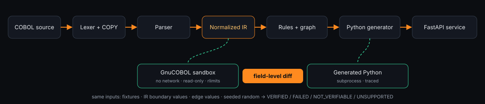
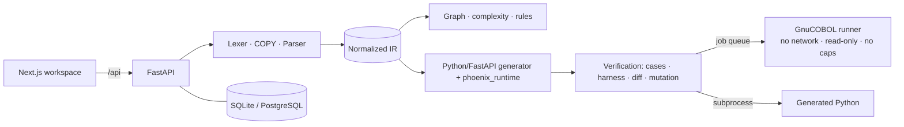

# Architecture (submission summary)

- **Deterministic core:** parsing, rules and generation never call an LLM; optional explanations are advisory.
- **Byte-accurate runtime:** every record is a `bytearray`; items are typed views, so REDEFINES, group moves and CALL BY REFERENCE match COBOL.
- **Differential proof:** identical bytes go into GnuCOBOL (via a generated harness) and Python; outputs are decoded with the record layout and compared field by field.
- **Isolation:** COBOL only runs in the runner container; generated Python runs in a scrubbed subprocess.

Full detail: `docs/architecture.md`, `docs/verification.md`, `SECURITY.md`.
